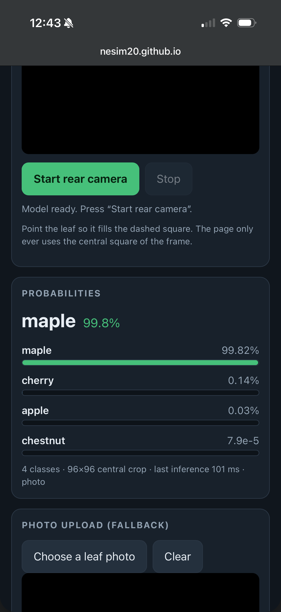

1. It runs on your phone
The application successfully runs on my mobile phone. After opening the GitHub Pages URL, the web page accessed the camera and classified the live feed.

2. The same numbers as the notebook
I uploaded the test image check_image.jpg using the photo upload fallback. The displayed probabilities match the values in check_expected.json (the "cherry" class shows 99.987%, while the rest are negligible). The maximum absolute difference is minimal (around 1.25e-7). This small residual is due to float32/JPEG noise and is well within the acceptable tolerance. The output is therefore identical to the Python notebook.

3. The preprocessing matches your model
I verified the source code in index.html. The preprocessing exactly matches the model requirements described in model_info.json. The code crops the central square of the frame, resizes it to 96×96 pixels, scales the RGB values by dividing by 255, and standardizes each channel using the provided mean and std. The input tensor is correctly shaped as 1x3x96x96. The ONNX model outputs raw logits, and the softmax function is applied afterwards directly in the page's JavaScript.

4. Nothing leaves the phone
The application is fully local and privacy-friendly. The live camera loop and uploaded photos are processed exclusively on the device. The page uses a standard MediaStream through the page's own requestAnimationFrame (rAF) loop for the camera and a local <input type="file"> for photo uploads. The inference runs entirely in the browser using the onnxruntime-web library. No image data is sent to any external server.
